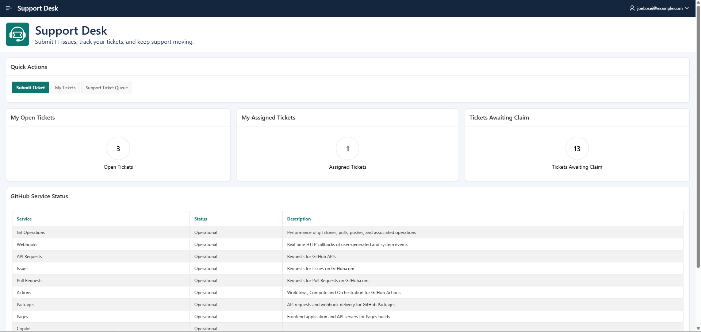
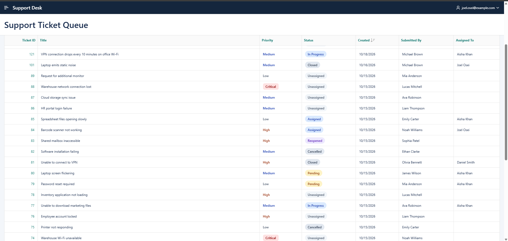
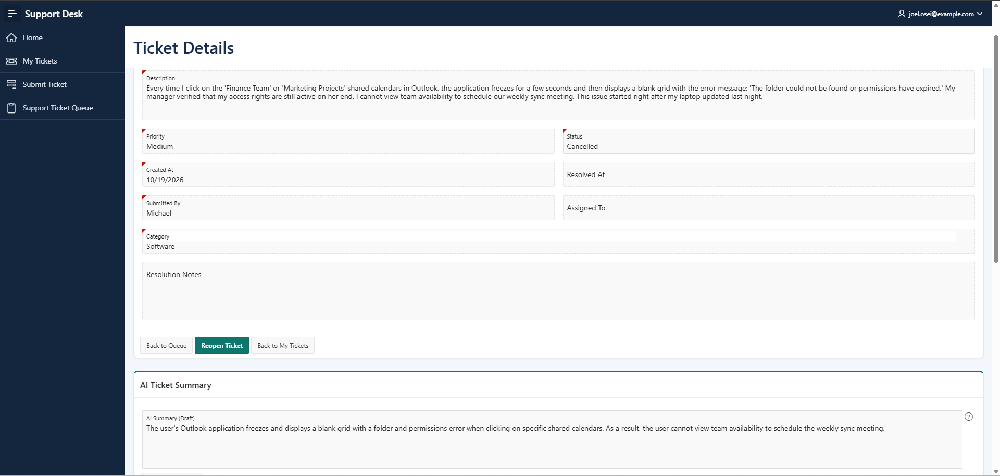
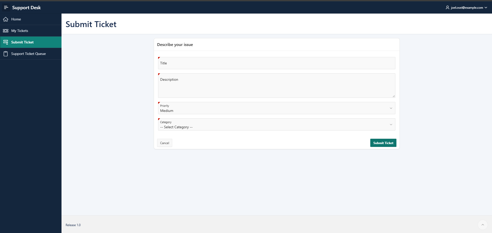
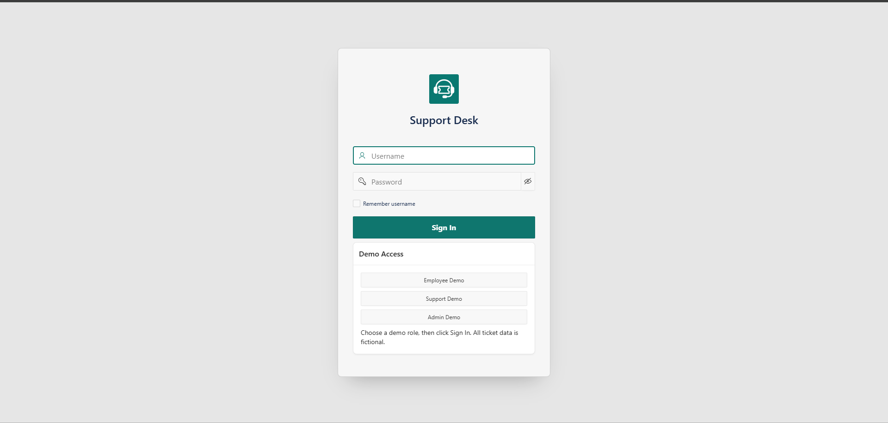

# Support Desk

An IT support ticket application built with Oracle APEX 26ai (26.1), Oracle SQL and PL/SQL. Employees report issues and track their tickets, support staff claim and work on tickets, and administrators oversee the ticket lifecycle.

[Open the live demo](https://gca2c3439af01cb-myappdb.adb.uk-london-1.oraclecloudapps.com/ords/r/myapp_ws/support-desk/home)

## Try the demo

On the sign-in page, choose **Employee Demo**, **Support Demo** or **Admin Demo**, then click **Sign In**. The buttons populate demo credentials; users still pass through the application's authentication process. All ticket data is fictional.

| Account | Role | Username | Demo password |
|---|---|---|---|
| Joel Osei | Admin | joel.osei@example.com | Admin123 |
| Aisha Khan | Support | aisha.khan@example.com | Support123 |
| Daniel Smith | Support | daniel.smith@example.com | Support123 |
| Michael Brown | Employee | michael.brown@example.com | Employee123 |

These credentials are intentionally public for this portfolio demonstration. Do not reuse them for private accounts.

## Features

- Dashboard with personal ticket counts, a support claim count and quick actions.
- Ticket submission with title, description, priority and category validation.
- Personal ticket report and a support queue with search, filters and visual status/priority labels.
- Ticket claiming and controlled status changes, including resolution, closure, cancellation and reopening.
- Comments with server-side access checks and a history of status changes.
- GitHub service status through a REST Data Source.
- AI-assisted, description-only ticket summaries for Admin and Support users.
- Custom branding, responsive layouts and an installable Progressive Web App.

## Screenshots

### Dashboard

### Support queue

### Ticket details and AI summary

### Submit a ticket

### Demo sign-in

## Architecture

| Layer | Responsibility |
|---|---|
| Oracle APEX | Pages, reports, forms, navigation, authorization schemes and dynamic actions |
| TS_PKG | Ticket operations, status-transition rules, validation and comment authorization |
| Oracle tables and constraints | Users, departments, categories, tickets, comments and status history; required values and relationships |
| Status-history trigger | Records old/new status, actor and date when a ticket's status changes |
| Standalone functions | Custom authentication, password hashing and dashboard REST error messages |
| REST Data Source | Retrieves and displays GitHub service status |
| APEX_AI.GENERATE | Sends a ticket description to a configured Gemini service and returns a draft summary |

The main pages are Dashboard (1), My Tickets (2), Submit Ticket (3), Support Queue (4), Ticket Details (5) and Sign In (9999).

Ticket operations identify the current APEX user through APP_USER. Claiming uses a conditional update so an already-claimed ticket cannot be claimed again. Status updates check the previously read status and assignee when writing, detecting conflicting changes. Adding a comment locks the ticket row with FOR UPDATE and uses a Boolean authorization flag that defaults to false.

TS_PKG maintains the resolved timestamp and clears assignment, resolution notes and the resolved date when reopening. The separate TRG_INSERT_RESOLVED_AT trigger is disabled in the live app and is not required for a new installation. Keep TRG_TICKET_STATUS_HISTORY enabled.

## Repository layout

| Folder | Contents |
|---|---|
| apex/f102 | Split APEX application export, including install.sql |
| database | Table definitions and fictional sample data |
| functions | Authentication, hashing and REST error-handler functions |
| packages | TS_PKG specification and body |
| triggers | Status-history trigger |
| screenshots | Application screenshots |

## Installation

The SQL scripts are intended for a **new, empty schema**, not for upgrading the live application. They have been reviewed as source files; a fresh installation from this repository has not yet been verified.

Use an Oracle database with Oracle APEX 26.1 installed and a workspace associated with the target parsing schema. The exported app was created with APEX 26.1.5. External features require outbound HTTPS access from the database environment.

Run the database scripts in this order, using a script runner that understands SQL*Plus-style `/` terminators:

1. database/01_create_tables.sql
2. functions/hash_password.sql
3. functions/authenticate_user.sql
4. functions/ts_dashboard_error.sql
5. packages/ts_pkg_spec.sql
6. packages/ts_pkg_body.sql
7. triggers/trg_ticket_status_history.sql
8. database/02_sample_data.sql

Check that the functions, package and trigger compile without errors. The sample-data script calls HASH_PASSWORD to initialise the demo accounts and commits its inserts. Run it once only. Sarah is included as sample ticket data without a login password.

Install the split application using apex/f102/install.sql with SQLcl or SQL*Plus from its directory. Configure the destination workspace, parsing schema and application ID with APEX_APPLICATION_INSTALL as appropriate for the target environment. The export contains application replacement statements: select an unused application ID when installing alongside an existing app. Supporting database objects are supplied separately by this repository.

### GitHub REST integration

The export includes the GitHub remote server and REST Data Source definitions. The endpoint is:

https://www.githubstatus.com/api/v2/summary.json

No API key is required. The report reads the components array, keeps showcase components and sorts by position. The configured source uses a short shared cache and a transfer timeout. The dashboard error function replaces recognised REST HTTP errors with a friendly message.

### Gemini integration

The split export contains the summary dynamic action but **does not include the workspace Gemini service or web credential definitions**. Recreate these in the target workspace:

- A Google Gemini Generative AI service with static ID `gemini-ticket-summarisation`.
- A web credential using HTTP header `x-goog-api-key`, restricted to `https://generativelanguage.googleapis.com/`.
- The service base URL `https://generativelanguage.googleapis.com/v1beta` and a model available to your account.

Associate the credential with the service. Enter your own API key in APEX's credential settings, never in repository files. Provider model availability, quotas and charges depend on the chosen account and model; verify them before use. The live demo was developed using a free-tier configuration without billing enabled.

The dynamic action submits P5_DESCRIPTION and returns P5_AI_SUMMARY. Its prompt requests no more than two short sentences, limits the response to supplied information and instructs the model to treat embedded instructions as data. The result is plain text, labelled as an AI draft, and must be reviewed. It does not automatically update the ticket, resolution or status. Generation failures display a friendly message.

Ticket descriptions are sent to the configured external AI provider when a user requests a summary. Use fictional data for the public demo. AI availability and response time depend on the provider and network.

## Validation performed

Manual checks on the live application covered role-based navigation and direct URL access, ticket workflows, comments, status history, resolution/reopening behaviour and responsive layouts. Display checks included escaping ticket titles and rendering comment HTML as literal text.

REST checks covered successful retrieval, an empty result and an HTTP error. AI checks covered generation, clearing summaries between tickets, role-based visibility, selected embedded-instruction examples and friendly failure handling. Observed successful generation was approximately 12 seconds in one test; this is not a response-time guarantee.

These checks describe the live app and are not an automated test suite or proof that every security case has been covered.

## Known limitations and remaining security work

This is a portfolio demonstration, and the security audit remains open:

- **Password hashing:** the current HASH_PASSWORD function uses APEX_UTIL.GET_HASH. Reviewing and replacing this with an appropriate password-storage approach remains deferred.
- **Ticket Access caching:** the ticket-dependent authorization scheme currently uses Once per Session caching. Its evaluation/caching behaviour remains unresolved and needs review before production use.
- **Reproducibility:** the repository's new-schema installation and the recreated Gemini configuration still need an end-to-end installation test. The included sample data is smaller than the live demonstration dataset.

The PWA and responsive UI have been exercised, but the application does not claim offline ticket management.
